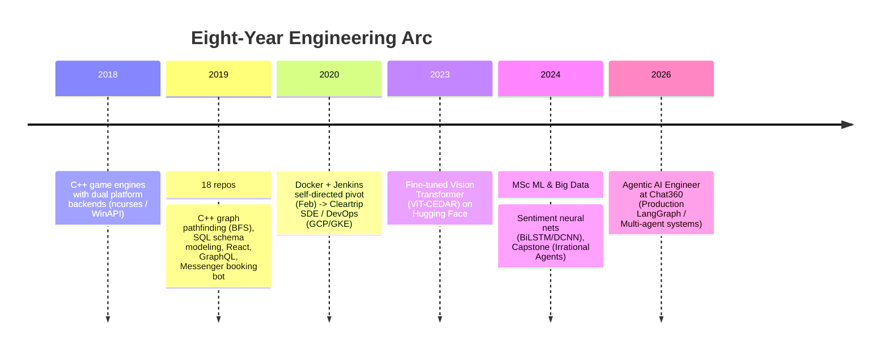

# Early Work Archive (2018 – 2020)

[_2017--2021-blue.svg)](#1-academic-alignment-code-matches-the-transcript)

An archived, curated collection of **22 repositories** built during my Bachelor of Engineering (Computer Science & Engineering) at Chitkara University and in the months immediately preceding my first production engineering role.

Originally published under my former GitHub handle (`KaranGoel59`, later `kgoel59`), these repositories were recovered from [Software Heritage](https://www.softwareheritage.org/) and consolidated here as a historical, immutable snapshot.

> **Notice:** This repository represents student projects from 2018–2020 preserved in their final archived state. Dependencies reflect their original era. All legacy `.env` configurations, build artifacts, and sensitive credentials have been thoroughly stripped and verified clean with `gitleaks`.

---

## Technical Analysis & Engineering Progression

This archive extends my public development history back to **October 2018** (spanning 8 years of engineering). More importantly, it provides the concrete code artifacts corresponding directly to university transcripts, early systems programming, and the foundation for production DevOps and Agentic AI work.

---

### 1. Academic Alignment: Code Matches the Transcript

Every major coursework milestone from the Chitkara BE transcript is backed by substantive code developed concurrently during each semester:

| Semester & Official Coursework | Grade | Concurrent Code & Architectural Proof |
|---|:---:|---|
| **Sem 3 (Jul–Dec 2018)**: OOP using C++, Linux | **Grade O** | Custom class-based game engines with decoupled `Engine`, `Scene`, `Level`, and `Cell` abstractions; separate POSIX `ncurses` and Windows `WinAPI` terminal renderers (`snake-game`, `spaceinvaders`, `2048`). |
| **Sem 4 (Jan–May 2019)**: Java, Client-side Tech, DBMS | **Grade O / A** | Relational schema modeling and normalized ER design implemented in low-level SQL (`qa-api`), early Canvas graphic pipelines (`hit-the-word-game`). |
| **Sem 5 (Jul–Dec 2019)**: Data Structures, Advanced JavaScript | **Grade O** | BFS shortest-path algorithms applied to game loops (`snake-ai`), graph-based random maze generation (`maze-game`), React/Apollo full-stack storefronts (`ecom-client`, `ecom-graphql`). |
| **Sem 6 (Jan–May 2020)**: AWS Modules 1 & 2, Integrated Project | **Grade A+ / O** | Microservices sandboxing: containerized C++ compilation engine running Monaco and WebSockets on an AWS host (`code-editor`). |

---

### 2. The Conversational AI Thread (2019 → Present)

A notable thread in this archive is [`pgi-bot`](./pgi-bot) (September 2019) — a Facebook Messenger appointment-booking bot built for a major hospital (PGIMER Chandigarh):
- **Architecture**: Webhook listener, account linking, intent routing, and a multi-step booking funnel (`Departments → Doctors → Slot Reservation → Confirmation`).
- **Significance**: Represents a continuous 6.5-year trajectory in conversational architectures:
  $$\text{Rule-based Messenger Bot (2019)} \longrightarrow \text{MSc Multi-Agent Capstone (2024--25)} \longrightarrow \text{Production Agentic AI at Chat360 (2026)}$$

---

### 3. The DevOps & Cloud Infrastructure Turn (Feb 2020)

Before joining Cleartrip Private Limited as an SDE intern on 02 March 2020, there was a deliberate pivot toward containerization, automated pipelines, and infrastructure as code:

- **02 Feb 2020** — [`express-typescript-template`](./express-typescript-template): First production-style microservice scaffold featuring automated Docker container builds and declarative `Jenkinsfile` CI pipelines.
- **24–28 Feb 2020** — [`spring-login-system`](./spring-login-system): Multi-module Java/Spring service orchestrating WebSocket authentication via `docker-compose` and Jenkins automation.
- **02 Mar 2020** — Cleartrip start: Transitioned directly into managing GKE clusters, HashiCorp Vault, and Terraform on GCP.
- **Multi-Cloud Progression**: Personal workloads started on **Azure** (`todolist-api` on App Service + Cosmos DB, 2019), moved through **AWS** (EC2 sandboxes, 2020), and solidified into **GCP / GKE** production infrastructure at scale.

---

## Repository Inventory (22 Projects)

### Systems Programming & C++ Engines (2018 – 2019)
| Directory | Timeline | Core Tech | Architectural Focus |
|---|---|---|---|
| [`snake-game`](./snake-game) | Oct 2018 – Jan 2019 | C++ · ncurses · WinAPI | Modular game engine with an abstract scene graph and dual platform backends (Linux terminal & Windows console). |
| [`spaceinvaders`](./spaceinvaders) | Oct 2018 | C++ · ncurses · WinAPI | Terminal arcade shooter utilizing decoupled input controllers and frame timing abstractions. |
| [`2048`](./2048) | Oct 2018 | C++ | Grid tile engine modeled through `Engine`, `GameManager`, `Level`, and `Cell` classes. |
| [`pacman`](./pacman) | Feb – Nov 2019 | C++ | Pac-Man engine featuring ghost scatter/chase state machines, collision interfaces, and double buffering. |
| [`maze-game`](./maze-game) | Feb – Nov 2019 | C++ | Graph-theoretic maze generator paired with Breadth-First Search (BFS) pathfinding and console UI. |
| [`snake-ai`](./snake-ai) | Mar 2019 | C++ | Autonomous snake navigation applying BFS path computation against a dynamic grid. |
| [`crawler`](./crawler) | Mar – Apr 2019 | C++ | Depth-limited prototype web crawler utilizing native sockets and HTTP parsing. |
| [`static-and-shared-c-cpp`](./static-and-shared-c-cpp) | Nov 2019 | C++ · GCC · Make | Demonstration repository analyzing static (`.a`) vs shared (`.so`/`.lib`) library compilation and linking dynamics. |

### Web, Full-Stack & APIs (2019 – 2020)
| Directory | Timeline | Core Tech | Architectural Focus |
|---|---|---|---|
| [`hit-the-word-game`](./hit-the-word-game) | Jan 2019 | JavaScript · HTML5 Canvas | Event-driven typing speed challenge utilizing a custom 2D canvas render loop. |
| [`qa-api`](./qa-api) | Feb – Mar 2019 | Node.js · Express · MySQL | Stack Overflow-style Q&A REST service built directly over low-level SQL drivers with an ER-modeled schema. |
| [`todolist-api`](./todolist-api) | Jul – Sep 2019 | TypeScript · Express · Azure | Cloud-native CRUD backend backed by Azure Cosmos DB, originally hosted on Azure App Service. |
| [`todolist`](./todolist) | Jul – Sep 2019 | React · CSS Modules | Single-page client consuming the `todolist-api`. |
| [`pgi-bot`](./pgi-bot) | Sep 2019 | TypeScript · Messenger API | Webhook-driven hospital booking bot handling patient registration and physician appointment slots. |
| [`grapql-login-system`](./grapql-login-system) | Sep 2019 | TypeScript · GraphQL · Sequelize | Modular authentication scaffold featuring GraphQL schemas, mutations, and ORM persistence. |
| [`ecom-client`](./ecom-client) | Sep 2019 – Jun 2020 | React · Apollo Client | E-commerce interface providing catalog browsing, shopping cart state, and administrative product management. |
| [`ecom-graphql`](./ecom-graphql) | Nov 2019 – Jun 2020 | TypeScript · GraphQL · JWT | Backend API pairing GraphQL schemas with JWT-based authorization and comprehensive TSDoc documentation. |
| [`web-snake`](./web-snake) | Nov 2019 | JavaScript · PixiJS · Webpack | High-performance 2D WebGL/Canvas game bundle with custom sprite atlases. |
| [`weather-app`](./weather-app) | Apr 2019 | Android (Java) | Native mobile client fetching and rendering asynchronous weather feeds. |
| [`holiday-calendar`](./holiday-calendar) | Dec 2019 – Jun 2020 | React | Calendar dashboard mapping regional holidays. |

### Distributed Systems, Tooling & CI/CD (2019 – 2020)
| Directory | Timeline | Core Tech | Architectural Focus |
|---|---|---|---|
| [`code-editor`](./code-editor) | Nov 2019 – Jun 2020 | React · Monaco · WebSockets · Docker | Collaborative online C++ IDE compiling and executing untrusted code inside sandboxed Docker containers (with Tanishq Malhotra). |
| [`express-typescript-template`](./express-typescript-template) | Feb 2020 | TypeScript · Jest · Docker · Jenkins | Standardized backend archetype with multi-stage Docker builds, testing suites, and a `Jenkinsfile` CI pipeline. |
| [`spring-login-system`](./spring-login-system) | Feb 2020 | Java · Spring Boot · WebSockets · Docker | Multi-module service combining Spring Security, token handling, and real-time WebSocket communication in Docker Compose. |

---

## Not included

26 of the 29 repositories archived under the old account are **not** in this
repository:

| Excluded | Why |
|---|---|
| `883-project-management`, `models` | Group coursework. Classmates' names, emails and student numbers appear in the content and commit history. |
| `chalkscrap` | Scrapes Chitkara's student portal (ChalkPad) — not something to republish. |
| `vault-kubernetes`, `k8s-newrelic-adapter`, `jenkins-docker` | Forks of other people's projects; only a handful of commits in each are mine. |
| `HOLIDAY_CALENDAR_REACT_PROJECT` | Not my work — its one commit is by a classmate, Aman Singla. |

(Full breakdown kept in private working notes, not published here.)

---

## Sanitization & security hygiene

1. **Source of truth**: extracted directly from the Software Heritage archive of the
   `kgoel59` account.
2. **Path pruning**: removed `.env` files, build caches (`bin/`, `build/`, `target/`),
   and `node_modules/`.
3. **Secret audit**: every file across all 22 folders was scanned with `gitleaks` and
   a manual sweep for connection strings and private-key blocks.
4. **What that audit actually found**: two real, live credentials — a MongoDB Atlas
   connection string (username + password) and a Google Cloud service-account private
   key, both in `pgi-bot`'s config files. An earlier version of this repository was
   briefly public with both still in plain text before this scan caught them. Both
   were stripped from **every commit** with `git-filter-repo` (not patched over), and
   placeholder files were committed in their place. The underlying MongoDB cluster and
   GCP project are confirmed abandoned and unused, so no credential rotation was
   needed. A third, lower-severity API key (Calendarific, in `holiday-calendar`) was
   also redacted.
5. **Current state**: re-scanned clean against the full history as of 2026-10-22.

---

## Active & Production Work

For current production engineering, modern open-source repositories, and agentic AI systems, visit:
- **GitHub Profile**: [@karangoel59-dev](https://github.com/karangoel59-dev)
- **Web Portfolio**: [karangoel59-dev.github.io/portfolio](https://karangoel59-dev.github.io/portfolio)
- **Hugging Face Models**: [@kg59](https://huggingface.co/kg59)
